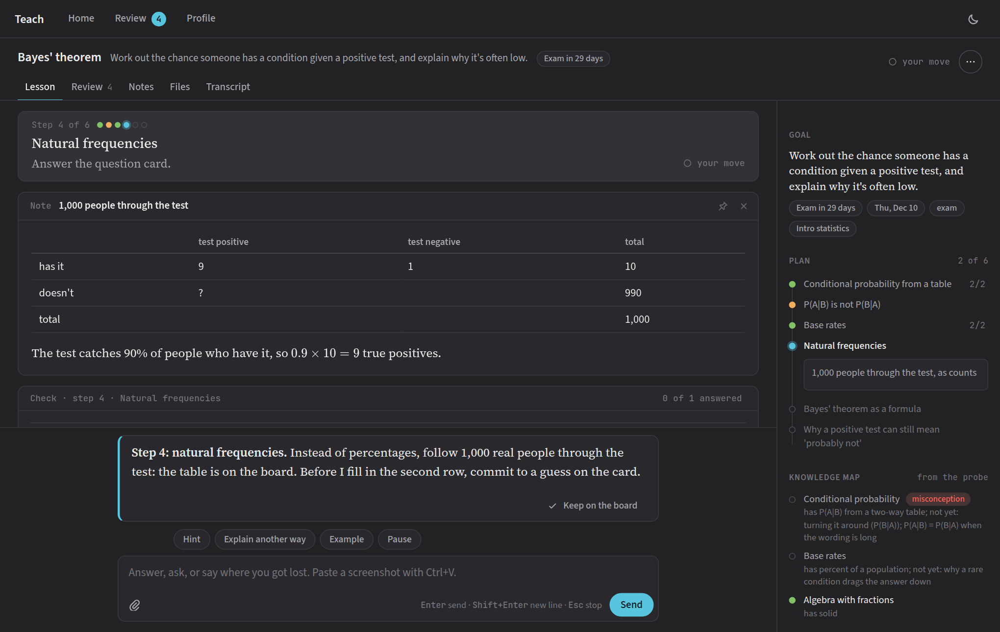
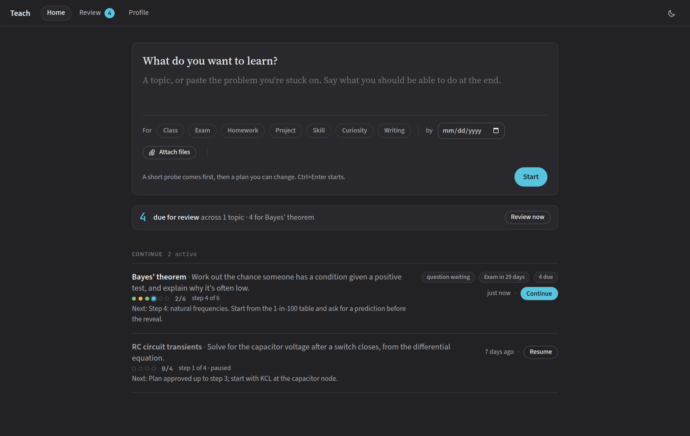
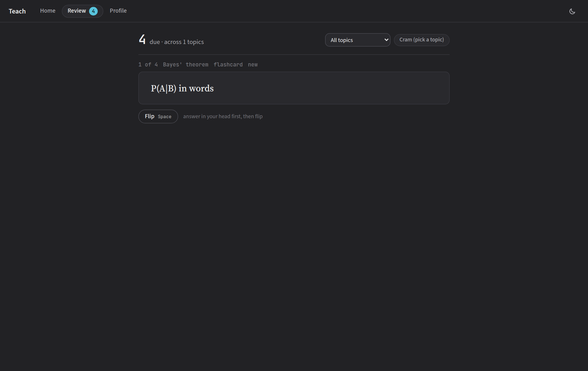

# Teach

A one-to-one tutor built on [Claude Code](https://docs.claude.com/en/docs/claude-code/overview). Tell it what you
want to learn. It probes what you already know with graded multiple-choice questions, plans a fact-checked path
from there to your goal, and teaches it one reasoning step at a time, checking you after each step. It keeps a
log, a knowledge map and a spaced-repetition deck for every topic, all in a local web app.



| Home | Review |
|---|---|
|  |  |

## What it does

- **Probe first.** It binary-searches the edge of what you know, strand by strand, before teaching anything.
- **Plan as a dependency graph.** Each node is one reasoning step. Subagents fact-check every definition,
  sign convention and formula the plan relies on before you see it.
- **One step per message.** You predict before the reveal, then a short check. It moves on only once you get
  the check right; a miss gets a different explanation and another check.
- **A board, not a chat.** The lesson is a workspace the tutor arranges: its notes, question cards, live scenes
  and figures stay in view while you work, and it clears them as the lesson moves on (a new step turns the page;
  pin what should stay). Its reply to your last move sits over the composer until your next one. Close, pin or
  keep anything yourself; the Transcript tab has the whole lesson in order.
- **Question cards with instant feedback**: choice, multi, typed text with a timer, numbers with units,
  ordering, and hands-on tasks (Done / Stuck).
- **Review**: every check becomes a card in a Leitner schedule (flashcards, multiple choice, type-it, traps,
  timelines, essay outlines), plus Cram for exam week and a printable review sheet.
- **Modes by purpose**: exam (sized to the days left), homework (parallel problems only, never the assigned
  one), writing (timed outlines and paragraphs; it edits, never writes for you), skill, curiosity.
- **Math and pictures**: LaTeX renders with KaTeX; the tutor draws diagrams as SVG and checks them before
  showing them; interactive HTML widgets run sandboxed.
- **Optional screen mode** (Linux, Sway/wlroots): with [screen-chalk](https://github.com/aidenwboudr/screen-chalk)
  installed, the tutor talks you through a real app out loud, marks your actual screen and watches you do each
  step.

Everything is plain files: `PROFILE.md` (what you know, how you like to learn; the tutor keeps it current) and one
folder per topic (`topic.json`, `log.md`, `deck.json`, `figures/`).

## Requirements

- **Linux** (macOS is untested; it relies on `/proc` for one cleanup step, and the installer uses systemd).
- **Node.js 22.5 or newer.** No npm dependencies.
- **Claude Code**, logged in. Each topic runs as a Claude Code session (`claude -p`), so you use your own
  Claude subscription or API key, however your Claude Code is set up (`claude` login, or `ANTHROPIC_API_KEY`).
  Teach never calls the Anthropic API itself and never sees your key.
- Optional: Chrome or Chromium, for `skill/render-svg.sh` (the tutor checks its diagrams with it).

## Install

```sh
npm install -g @anthropic-ai/claude-code   # if you don't have Claude Code yet; then run `claude` once to log in
git clone https://github.com/aidenwboudr/teach.git ~/teach
cd ~/teach && ./install.sh --demo
```

`install.sh` puts the `teach` command in `~/.local/bin`, links the skill into `~/.claude/skills/teach`, creates
your learning folder (`~/.local/share/teach`, with `--demo` two example topics), and starts a systemd user service.
Open **http://127.0.0.1:7800**, or run `teach`.

No systemd (a container, WSL without it)? `./install.sh --no-service --demo`, then `node server.mjs`.

From any Claude Code chat, `/teach <topic>` (or "teach me …") hands the topic to the app.

## Settings

Everything is an environment variable. The service reads `~/.config/teach/env` (KEY=VALUE lines, through
systemd's `EnvironmentFile`), and so does the `teach` command. A server you start by hand with `node server.mjs`
reads only its own environment, so a dev server never picks up a live setup. `TEACH_CONFIG` points the command
at another file (`/dev/null` turns it off).

| Variable | Default | What |
|---|---|---|
| `TEACH_DATA` | `~/.local/share/teach` | Learning folder: `PROFILE.md` and `topics/` |
| `TEACH_WORK` | the learning folder | Where tutor sessions run (their working directory; they can read files there) |
| `TEACH_STATE` | `~/.local/state/teach` | Machine-local state: review schedule, answers, uploads, `claude.log` |
| `TEACH_PORT` / `TEACH_HOST` | `7800` / `127.0.0.1` | Where it listens |
| `TEACH_URL` | `http://127.0.0.1:$TEACH_PORT` | The address `teach` uses and prints |
| `TEACH_SOCKET` | (off) | Listen on this Unix socket (mode 0600) instead of TCP, for a reverse proxy |
| `TEACH_TS_USER` | (none) | With `TEACH_SOCKET` behind Tailscale Serve: the only tailnet login let through |
| `TEACH_LEARNER` | `the learner` | What the tutor calls you (a first name reads better) |
| `TEACH_CLAUDE` | `claude` | The Claude Code binary (or a wrapper) |
| `TEACH_MODEL` | per topic (Opus) | Force a model for every tutor (e.g. `sonnet`) |
| `TEACH_SAFE` | off | `1`: tutors get no shell (read, web, and writes only in the learning folder) |
| `TEACH_SYNC` | off | `git-pr`: when the learning folder is in a GitHub checkout, ship changes as a PR and squash-merge it (needs `gh`) |
| `TEACH_BROWSER` | `xdg-open {url}` | How `teach open` opens the app, e.g. `chromium --app={app}` |
| `TEACH_OPEN_CMD` | (none) | With `{app}` windows: a command that opens clicked links in your own browser |
| `TEACH_CAPTURE_CMD` | (none) | A command that prints your newest photo (JPEG) to stdout; adds a camera button |
| `TEACH_FOCUS_STATE` | (none) | A focus tool's state file; while it's active, tutors lose the shell |
| `TEACH_T3_DB` | `~/.t3/userdata/state.sqlite` | T3 Code's database, for chat titles under "From other chats" |
| `TEACH_CHALK`, `TEACH_CHALK_MCP` | `chalk`, `chalk-mcp` on PATH | screen-chalk, for screen mode |

## Security: read this

- **By default a tutor has a full shell** (`--permission-mode bypassPermissions`): it runs commands as you,
  without asking, so it can draw figures, run code and check its work. Set `TEACH_SAFE=1` if you don't want
  that; tutors then read, search the web, and write only inside the learning folder.
- The page can show files under the learning and work folders and under `~/Documents`, `~/Downloads`,
  `~/Pictures` and `~/Videos` (never dotfiles), because the tutor links them in lessons. It answers only on
  localhost (or the socket); don't put it on a public address. For remote use, put the socket behind an
  authenticating proxy (Tailscale Serve plus `TEACH_TS_USER` is what it was built with).
- Tutors run with your normal Claude Code setup (your settings, hooks, MCP servers and memory).
- HTML widgets the tutor writes run sandboxed (no network, opaque origin).

## The `teach` command

```
teach                       open the app
teach new "what" [--why exam] [--deadline 2026-12-10] [--file notes.pdf]
teach list                  topics and where each stands
teach bring                 bring /teach sessions from other Claude Code chats into the app
teach update|plan|step|cards <slug> '<json>'   keep a topic current from a chat outside the app
teach sync                  with TEACH_SYNC=git-pr
teach help
```

## How it works

- `server.mjs`: the HTTP server (Node built-ins only) and the page's API.
- `lib/engine.mjs`: one `claude -p --input-format stream-json` process per topic being taught, with the `teach`
  MCP server (`mcp.mjs`: `ask`, `update`, `plan`, `step`, `cards`, `board`, `show`, `scene`) attached; its stream
  becomes lesson events. An idle tutor closes after 20 minutes; the next message resumes the same session.
- `lib/board.mjs`: the lesson board and its rules (what replaces what, what leaves by itself), a fold over the
  lesson's history and the learner's own board actions, so it can always be rebuilt.
- `lib/transcript.mjs`: Claude Code transcripts → the lesson's history, and finding /teach sessions from other chats.
- `lib/review.mjs`: the Leitner schedule (20 new items a day). `lib/screen.mjs`, `screen.md`: screen mode.
- `skill/SKILL.md`: the teaching method the tutor follows. A `skill/local.md` next to it, if you write one, is
  read first: put your own additions there (who you are, your courses' conventions) and keep `SKILL.md` as is.
- `public/`: the page in plain JavaScript (`app.js`, and `board.js` for the lesson board), no build step. KaTeX
  and marked are vendored.

## Develop

```sh
npm test                                    # unit tests, throwaway data
npm run check                               # syntax check
TEACH_DATA=/tmp/teach-dev TEACH_PORT=7801 TEACH_MODEL=haiku node server.mjs   # a dev server on its own data
node examples/demo/build.mjs                # rebuild the demo topics
PLAYWRIGHT=…/playwright/index.mjs node docs/screenshots.mjs   # the README screenshots, from the demo data
```

See [CONTRIBUTING.md](CONTRIBUTING.md).

## Credits

Teach follows the one-to-one learning method from Eero Alvar's video
["How I Use AI to Learn Things"](https://www.youtube.com/watch?v=kzcI5F4tGiU) and the idea in his
["Bodybuilding for the Mind"](https://www.youtube.com/watch?v=o0DtxUJ6rAc): AI should add thinking load, not take it
away. His channel is [@EeroAlvar](https://www.youtube.com/@EeroAlvar). His own system is on GitHub as amosblomqvist:
[learn](https://github.com/amosblomqvist/learn) (his setup for the Pi agent) and
[learnharness](https://github.com/amosblomqvist/learnharness) (a desktop app, AGPL-3.0). Vasanth Sreeram's
[Alvarmethod](https://github.com/vasanthsreeram/Alvarmethod) (MIT) ports the method as Agent Skills. Teach's text
and code were written independently; they use the method, not those projects' files.

Vendored: [KaTeX](https://katex.org) and [marked](https://marked.js.org) (MIT), Source Serif 4 and Source Sans 3
(Adobe, SIL OFL 1.1), JetBrains Mono (SIL OFL 1.1). Their licenses are next to them in `public/`.

## License

MIT, see [LICENSE](LICENSE).
