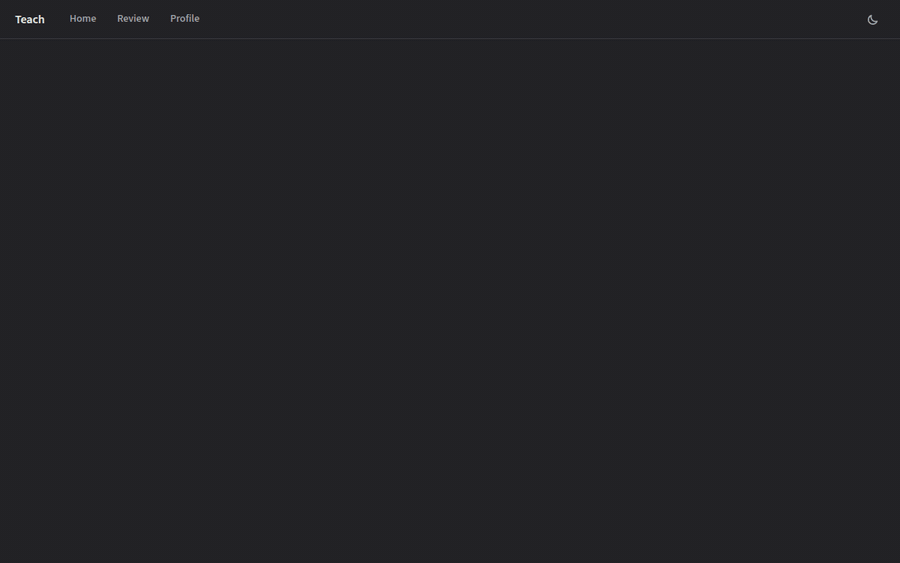
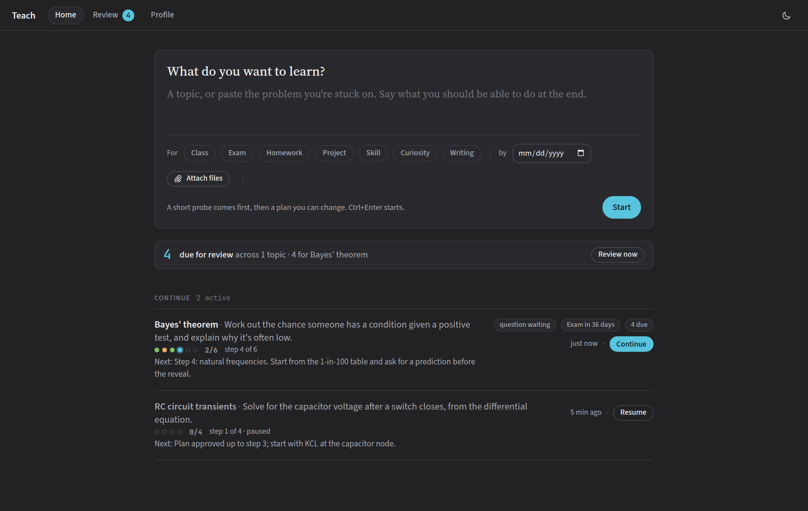
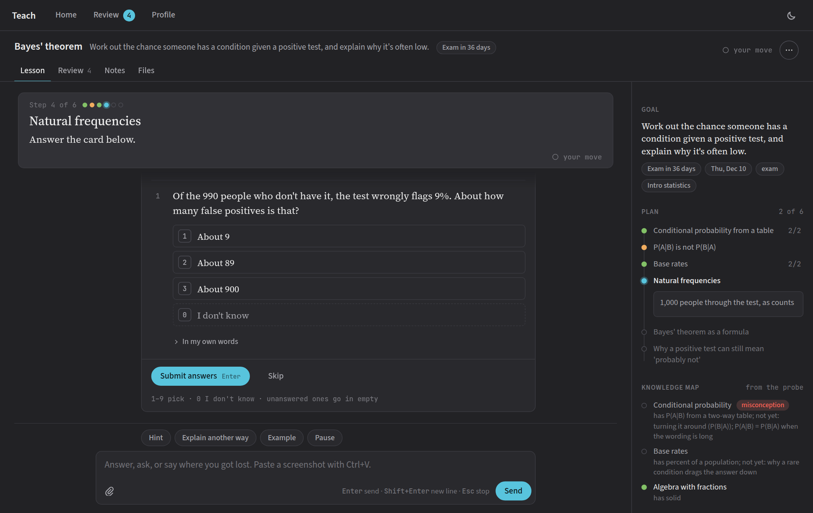
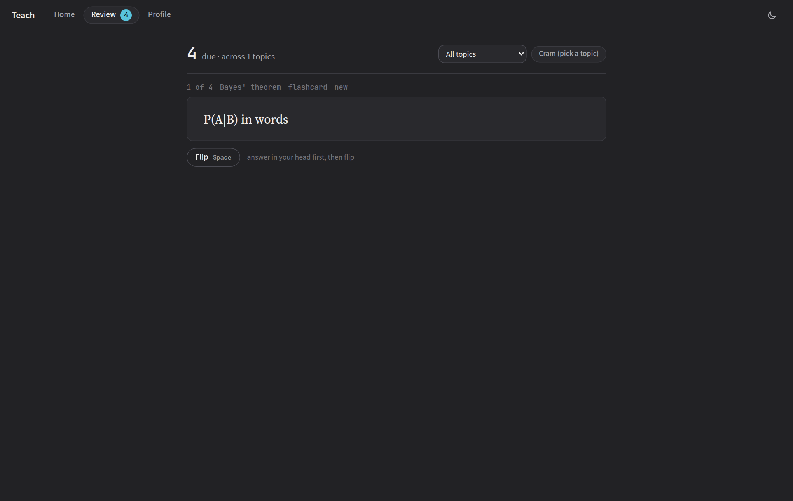

# Teach

A one-to-one tutor that runs on the AI agent you already use: [Claude Code](https://docs.claude.com/en/docs/claude-code/overview)
(the default), OpenAI's [Codex](https://developers.openai.com/codex/cli), Google's
[Gemini CLI](https://github.com/google-gemini/gemini-cli), or a local model. Tell it what you want to learn. It probes what you already know with graded multiple-choice questions, plans a fact-checked path
from there to your goal, and teaches it one reasoning step at a time, checking you after each step. It keeps a
log and a knowledge map for every topic, and makes the sheet, worksheet or deck you ask for at the end, all in a local web app.



| Home | Lesson | Review |
|---|---|---|
|  |  |  |

*Recorded from the demo topics with a scripted stand-in for the tutor (`docs/screenshots.mjs`).*

## What it does

- **Probe first.** It binary-searches the edge of what you know, strand by strand, before teaching anything.
- **Plan as a dependency graph.** Each node is one reasoning step. Subagents fact-check every definition,
  sign convention and formula the plan relies on before you see it.
- **One step per message.** You predict before the reveal, then a short check. It moves on only once you get
  the check right; a miss gets a different explanation and another check.
- **A board, not a chat.** The lesson is a workspace the tutor arranges: its notes, question cards, live scenes
  and figures. It decides what's in view and how: one thing given the room, a scene with its note beside it, two
  figures side by side, or its own rows. What it's done with folds onto a shelf of one-line chips, one click from
  coming back; a new step turns the page (pin what should stay). Its reply to your last move sits by the composer
  until your next one. Fold, open, pin or close anything yourself; **F** (or the Focus button) hides everything but
  the board, Esc leaves; the Transcript tab has the whole lesson in order.
- **Question cards with instant feedback**: choice, multi, typed text with a timer, numbers with units,
  ordering, and hands-on tasks (Done / Stuck).
- **What next, when you want it**: when a session ends, a grid of actions that fit the topic, best first: a note
  sheet sized to what your exam allows (page count, sides, font, what to include), a printable worksheet with a
  separate answer key, a timed practice test, a review session on your calendar, flashcards, a bench or reference
  card, exercises to do on your own, lesson notes. Each stays grey until you click it; nothing is generated (and
  no usage spent) before that, and you can pause one mid-way and resume it later. PDFs are fitted to the page
  budget in headless Chrome and checked before you get them.
- **Review**: flashcards you asked for go into a Leitner schedule (multiple choice, type-it, traps, timelines,
  essay outlines), daily until an exam or spaced, plus Cram for exam week.
- **Modes by purpose**: exam (sized to the days left), homework (parallel problems only, never the assigned
  one), writing (timed outlines and paragraphs; it edits, never writes for you), skill, curiosity.
- **Whole courses, and programs of them**: the Courses tab takes a real course (its syllabus, lectures, readings,
  graded work and exams, read from its own pages) and teaches it one unit at a time, each unit a topic of its own. A
  program puts courses in order for a whole major or track: requirement slots (foundation, core, theme, capstone), a
  free course behind each, prerequisites first, at a pace you set. Each course opens with a graded multiple-choice
  pre-test, so the lessons cover only what you don't know yet, and its hours come from its own lecture time, reading
  load and graded work. Written work is marked against the rubric by a grader that isn't your tutor; a real exam is one
  timed, closed-book sitting, and a practice version (labelled so) can be retaken. A course stitched together from
  several sources says so, and from where. A course "professor" reviews the evidence each week (scores, retention,
  deadlines kept, the sessions you finish, your school load) and re-paces how you get there, never the exams; every
  change is logged with its reason and can be undone. Deadlines can go on your calendar, and a weekly check-in can go
  wherever `TEACH_CHECKIN_CMD` sends it. `examples/courses/` and `examples/programs/` have one of each (MIT's Minds and
  Machines; a PPE major).
- **Math and pictures**: LaTeX renders with KaTeX; the tutor draws diagrams as SVG and checks them before
  showing them; interactive HTML widgets run sandboxed.
- **Optional screen mode** (Linux with Sway or another wlroots compositor only): with
  [screen-chalk](https://github.com/aidenwboudr/screen-chalk) installed, the tutor talks you through a real app out
  loud, marks your actual screen and watches you do each step. Turn it on for a whole lesson ("On my screen"), or
  let the tutor take single steps there by itself when they're about something on your screen (a program, a
  datasheet, your code) and come back to the board after. It doesn't when your screen is locked or asleep or
  you're typing in Teach, and "Stay on the board" stops it for that topic. Everything else works on Linux,
  macOS, Windows and in Docker.

Everything is plain files: `PROFILE.md` (what you know, how you like to learn; the tutor keeps it current) and one
folder per topic (`topic.json`, `log.md`, `deck.json`, `figures/`).

## Requirements

- **Linux, macOS or Windows** (or Docker anywhere). Screen mode needs Linux with Sway.
- **Node.js 22.5 or newer.** No npm dependencies.
- **One AI agent CLI, logged in**: Claude Code (default), Codex, Gemini CLI, or Codex pointed at a local model (see
  [Which AI](#which-ai)). Each topic runs as a session of that CLI, on your own subscription, login or key, however
  that CLI is set up. Teach never calls a model API itself and never sees or stores a key.
- Optional: Chrome, Edge or Chromium, so the tutor can check the diagrams it draws (Edge comes with Windows).

## Install

```sh
npm install -g teach-tutor && teach setup --demo
```

Then open **http://127.0.0.1:7800** (or run `teach`). Don't have Claude Code yet? `npm install -g
@anthropic-ai/claude-code`, then run `claude` once to log in. On another AI: `teach setup --provider codex` (or
`gemini`, or `local --model <name>`); run in a terminal, `teach setup` asks.

`teach setup` creates your learning folder (`~/.local/share/teach`; `--demo` adds two example topics), saves which AI
tutors run on (`TEACH_PROVIDER`) and checks that its CLI is installed and logged in, links the skill into
`~/.claude/skills/teach`, and keeps the server running in the background:

| | How it runs | Logs |
|---|---|---|
| Linux | a systemd user service, `teach.service` | `journalctl --user -u teach -f` |
| macOS | a launchd agent, `local.teach` (`~/Library/LaunchAgents`) | `~/.local/state/teach/server.log` |
| Windows | started now, and at sign-in from your Startup folder (`Teach.lnk`, no window) | `~/.local/state/teach/server.log` |

`teach setup --no-service` skips that; run `teach serve` in a terminal when you want it. On Windows, WSL works
too: inside it, follow the Linux steps (with systemd enabled in WSL, or `--no-service`).

From any Claude Code chat, `/teach <topic>` (or "teach me …") hands the topic to the app (from any other chat, run
`teach new "<topic>"`).

From a git checkout instead: `git clone https://github.com/aidenwboudr/teach.git && cd teach && ./install.sh --demo`
(`node cli.mjs setup --demo` on Windows). Same options.

### Which AI

Every topic runs the same method (probe, a fact-checked plan, one checked step at a time, question cards, the board,
review) through the same `teach` tools. What changes is the CLI underneath, how much of its safety Teach can
enforce, and a few features.

| `TEACH_PROVIDER` | Runs | Sign in (the CLI's own) | Restricted mode (the default) | Not available |
|---|---|---|---|---|
| `claude` (default) | `claude -p` | `claude` login, or `ANTHROPIC_API_KEY` | Teach answers each of Claude Code's permission checks: no shell, reads in the learning and work folders, writes only in the learning folder | |
| `codex` | `codex exec --json`, one process per turn | `codex login` (ChatGPT) or `codex login --with-api-key` (or `CODEX_API_KEY`) | Codex's shell, exec and image tools are off and its sandbox is read-only; the tutor reads and writes through the `teach` file tools, which check every path the same way | screen mode, the model picker (`TEACH_MODEL` sets one), subagents |
| `gemini` | `gemini -o stream-json`, one process per turn | a Gemini API key in Gemini CLI's own config (`GEMINI_API_KEY` in `~/.gemini/.env`, from [AI Studio](https://aistudio.google.com/apikey)) or Vertex AI | a policy file denies its shell and its own write tools; its read tools stay, and Gemini CLI keeps them inside its workspace (the work and learning folders, Teach's uploads, the tutor's own folder in Teach's state); writes go through the `teach` file tools | screen mode, the model picker, effort, subagents |
| `local` | Codex CLI with a local model provider | none: a model server at `TEACH_LOCAL_URL` (Ollama by default) and `TEACH_MODEL` | as `codex` | as `codex`, and effort |

Things to know:

- **Google sign-in doesn't work for Gemini CLI any more** for individual accounts (it answers "This client is no
  longer supported for Gemini Code Assist for individuals"). Use an API key. `teach setup` sends Gemini CLI one test
  prompt to check, and tells you if that's what it hit.
- **Local models need a big enough context and a tool-calling model.** The tutor's instructions plus Codex's own are
  about 15k tokens, and Ollama's default context is 4096, which cuts them off. Give the model at least 32k
  (`OLLAMA_CONTEXT_LENGTH=32768` for the Ollama server, or a model made with `PARAMETER num_ctx 32768`). The server
  must speak OpenAI's Responses API (`/v1/responses`): Ollama, LM Studio and vLLM do; Codex no longer supports the
  older chat-completions API. If it needs a key, put it in an environment variable and name that variable in
  `TEACH_LOCAL_KEY_ENV` (Codex reads it; Teach doesn't). Small models work but
  slowly and loosely: a 9B model on a CPU-only machine followed the method (profile, goal, probe card, plan, first
  step, board note, log) at 5 to 15 minutes a turn, and sometimes sent a malformed card. Use the largest model you can
  run, on a GPU if you have one.
- **Fact-checking.** On Claude Code, subagents check the plan. Elsewhere the tutor checks it itself, with web search,
  in the same session.
- **Switching AI** keeps every topic, its plan, log, deck and history. A session only resumes on the AI it ran on,
  so after a switch the next message starts a fresh session that reads the topic's state and log and carries on.
- Codex's and Gemini's own session files stay where those CLIs keep them; Teach also writes each session's lesson
  history to `~/.local/state/teach/transcripts/`, which is what the lesson page is rebuilt from.

### Docker

```sh
git clone https://github.com/aidenwboudr/teach.git && cd teach
docker compose run --rm teach claude      # log Claude Code in once (then /exit); the login stays in a volume
TEACH_DEMO=1 docker compose up -d         # http://127.0.0.1:7800
```

For Codex or Gemini CLI in the image, build with them (`docker compose build --build-arg WITH_CODEX=1` or
`--build-arg WITH_GEMINI=1`), set `TEACH_PROVIDER` in `.env`, and log in the same way (`docker compose run --rm teach
codex login --device-auth`). Your learning folder is `./learning` next to `compose.yaml` (`TEACH_FOLDER=/path/to/folder` picks another). Instead
of logging in, you can put `CLAUDE_CODE_OAUTH_TOKEN` (from `claude setup-token`) or `ANTHROPIC_API_KEY` in a `.env`
file next to `compose.yaml`. The container runs as uid 1000; on Linux, give that user write access to the folder.

## Settings

Everything is an environment variable. `~/.config/teach/env` holds them (KEY=VALUE lines): the Linux service
reads it through systemd's `EnvironmentFile`, `teach serve` (macOS, Windows, Docker) and the `teach` command load it
themselves. A server you start by hand with `node server.mjs` reads only its own environment, so a dev server never
picks up a live setup. `TEACH_CONFIG` points at another file (`/dev/null` turns it off). Restart the server after
changing it (`systemctl --user restart teach`, `launchctl kickstart -k gui/$(id -u)/local.teach`, or
`teach setup` again on Windows).

| Variable | Default | What |
|---|---|---|
| `TEACH_ACCESS` | `restricted` | What tutors may do; `full` gives them a shell (see Security) |
| `TEACH_DATA` | `~/.local/share/teach` | Learning folder: `PROFILE.md` and `topics/` |
| `TEACH_WORK` | the learning folder | Where tutor sessions run (their working directory; they can read files there) |
| `TEACH_STATE` | `~/.local/state/teach` | Machine-local state: review schedule, answers, uploads, the tutor CLI's log (`claude.log`, `codex.log`, `gemini.log`) |
| `TEACH_PORT` / `TEACH_HOST` | `7800` / `127.0.0.1` | Where it listens |
| `TEACH_URL` | `http://127.0.0.1:$TEACH_PORT` | The address `teach` uses and prints (the server answers to its host name too) |
| `TEACH_SOCKET` | (off) | Listen on this Unix socket (mode 0600) instead of TCP, for a reverse proxy |
| `TEACH_TS_USER` | (none) | With `TEACH_SOCKET` behind Tailscale Serve: the only tailnet login let through |
| `TEACH_LEARNER` | `the learner` | What the tutor calls you (a first name reads better) |
| `TEACH_PROVIDER` | `claude` | Which AI tutors run on: `claude`, `codex`, `gemini` or `local` (see [Which AI](#which-ai)) |
| `TEACH_CLAUDE` | `claude` | The Claude Code binary (or a wrapper) |
| `TEACH_CODEX`, `TEACH_GEMINI` | `codex`, `gemini` | The Codex and Gemini CLI binaries |
| `TEACH_MODEL` | per topic (Opus) on Claude Code; the CLI's default elsewhere | Force a model for every tutor, in that CLI's naming (e.g. `sonnet`, `gpt-5.5`, `gemini-2.5-pro`, `qwen3:32b`); required for `local` |
| `TEACH_LOCAL_URL` | `http://127.0.0.1:11434/v1` | `local`: the model server (OpenAI-style, with the Responses API) |
| `TEACH_LOCAL_KEY_ENV` | (none) | `local`: the name of the variable that holds that server's key, if it needs one |
| `TEACH_CHROME` | found by itself (`chrome-headless-shell` first) | The browser that renders the tutor's diagrams and the PDFs the end-of-session actions make |
| `TEACH_CALENDAR_CMD` | (none) | Adds a scheduled review session to your calendar: gets `TITLE "YYYY-MM-DD HH:MM" --for 30m --note TEXT [--remind 30m]`. Without it, the session gets an .ics download |
| `TEACH_CALENDAR_MOVE_CMD` | (none) | Courses: moves an event the app added (gets the ID the add command printed in `[brackets]`, then `"YYYY-MM-DD HH:MM"`), so a re-paced deadline is moved, not added twice |
| `TEACH_CHECKIN_CMD` | (none) | Courses: delivers the weekly check-in and a program's start to you: gets `MESSAGE --key KEY [--urgent]` (urgent: you're behind). Without it, check-ins show only in the app |
| `TEACH_SCHOOL_CMD` | (none) | Courses: your school, as JSON, so the weekly load follows it. `weeks --from MONDAY --weeks N` prints `{"weeks": [{"monday", "exams", "due", "busyHours", "finals", "break", "labels": []}]}`; `open --from DAY --through DAY` prints `{"open": [{"course", "title", "due"}], "fresh": ISO}` (work not turned in yet, for a program that starts once it is) |
| `TEACH_SYNC` | off | `git-pr`: when the learning folder is in a GitHub checkout, ship changes as a PR and squash-merge it (needs `gh`) |
| `TEACH_BROWSER` | the system's opener | How `teach open` opens the app, e.g. `chromium --app={app}` |
| `TEACH_OPEN_CMD` | (none) | With `{app}` windows: a command that opens clicked links in your own browser |
| `TEACH_CAPTURE_CMD` | (none) | A command that prints your newest photo (JPEG) to stdout; adds a camera button |
| `TEACH_FOCUS_STATE` | (none) | A focus tool's state file; while it's active, tutors lose the shell |
| `TEACH_T3_DB` | `~/.t3/userdata/state.sqlite` | T3 Code's database, for chat titles under "From other chats" |
| `TEACH_CHALK`, `TEACH_CHALK_MCP` | `chalk`, `chalk-mcp` on PATH | screen-chalk, for screen mode |

## Security: read this

- **By default a tutor has no shell**, on every AI. On Claude Code, Teach answers its permission checks itself: a
  tutor can read the learning and work folders, search and fetch from the web, use subagents and the teach tools (it
  checks its diagrams with the `render` tool), and write only inside the learning folder. Everything else is refused,
  Bash included. On Codex and local models, Codex's shell, exec and image tools are turned off and its sandbox is
  read-only, so the tutor reads and writes only through the `teach` file tools, which apply the same folder rules.
  On Gemini CLI, a policy file denies its shell and its own write tools; its read tools stay, limited by Gemini CLI
  itself to its workspace (the work and learning folders, Teach's uploads and the tutor's folder in Teach's state),
  so that boundary is Gemini's, not Teach's.
- **`TEACH_ACCESS=full`** gives tutors a full shell that runs commands as you, without asking, so a tutor can run code
  and check its work: `--permission-mode bypassPermissions` on Claude Code, `--dangerously-bypass-approvals-and-sandbox`
  on Codex, yolo mode on Gemini CLI. Turn it on only if you're fine with that (in the Docker image, the shell is
  inside the container).
- Restricted isn't a sandbox against a determined prompt injection: a tutor can still fetch web pages, so anything
  in your learning folder could leave through a URL. Keep secrets out of it.
- The page can show files under the learning and work folders and under `~/Documents`, `~/Downloads`,
  `~/Pictures` and `~/Videos` (never dotfiles), because the tutor links them in lessons. It answers only on
  localhost (or the socket); don't put it on a public address. For remote use, put the socket behind an
  authenticating proxy (Tailscale Serve plus `TEACH_TS_USER` is what it was built with).
- Tutors run with your normal setup for that CLI (your settings, hooks, MCP servers and memory), which can widen
  what they may do: an MCP server you added to Claude Code, Codex or Gemini CLI is the tutor's too.
- HTML widgets the tutor writes run sandboxed (no network, opaque origin).

## The `teach` command

```
teach                       open the app
teach new "what" [--why exam] [--deadline 2026-12-10] [--file notes.pdf]
teach list                  topics and where each stands
teach bring                 bring /teach sessions from other Claude Code chats into the app
teach update|plan|step|cards <slug> '<json>'   keep a topic current from a chat outside the app
teach sync                  with TEACH_SYNC=git-pr
teach course import FILE.json [--replace]     add a course (examples/courses/)
teach program import FILE.json [--replace]    add a program of courses (examples/programs/)
teach courses               programs and courses, and where each stands
teach program start <slug>  start a program now
teach note "busy week, travelling" [--week YYYY-MM-DD]   a note the course professor reads (kept on this machine)
teach checkin [--dry]       run the weekly course check-in now
teach serve                 run the server in this terminal (with ~/.config/teach/env loaded)
teach setup [--provider claude|codex|gemini|local] [--model NAME] [--demo] [--no-service] [--no-skill] [--no-check]
                            install or refresh
teach help
```

## How it works

- `server.mjs`: the HTTP server (Node built-ins only) and the page's API.
- `lib/engine.mjs`: one tutor process per topic being taught, with the `teach` MCP server (`mcp.mjs`: `ask`,
  `update`, `plan`, `step`, `cards`, `board`, `show`, `scene`, and the `file_*` tools for restricted tutors outside
  Claude Code, `lib/files.mjs`) attached; its stream becomes lesson events. An idle tutor closes after 20 minutes; the
  next message resumes the same session.
- `lib/providers/`: the AI services. `index.mjs` starts and checks each CLI and sets what it may do; `turns.mjs` makes
  a one-process-per-turn CLI (Codex, Gemini) look like Claude Code's long-lived stream-json process and records its
  transcript; `translate.mjs` turns their JSONL events into Claude Code's stream-json; `relay.mjs` sits between Codex
  and a local model server, because Codex sends MCP tools as a Responses API "namespace" that local servers flatten,
  and then can't route their calls back (the relay sends plain functions and puts the namespace back on the calls).
- `lib/board.mjs`: the lesson board and its rules (what replaces what, what leaves by itself, what's in view and how
  it's arranged), a fold over the lesson's history and the learner's own board actions, so it can always be rebuilt.
- `lib/transcript.mjs`: Claude Code transcripts → the lesson's history, and finding /teach sessions from other chats.
- `lib/review.mjs`: the Leitner schedule (20 new items a day). `lib/screen.mjs`, `screen.md`: screen mode.
- `lib/courses.mjs`: courses and programs (the store, hours, the schedule, a program's timeline, the gradebook, where a
  course comes from); `lib/professor.mjs`: the rules that re-pace a course from the evidence, each small and tested on
  recorded histories (`test/professor.test.mjs`); `lib/coursework.mjs`: what needs one model call (loading a course from
  its pages, the pre-test, a real exam as question cards, a practice version, grading); `lib/courseapp.mjs`: their API,
  exam sittings, a program's start rule and the check-in. `public/course.js` is the Courses tab.
- `lib/platform.mjs`: what differs on Linux, macOS and Windows; `lib/setup.mjs`: `teach setup`.
- `skill/SKILL.md`: the teaching method the tutor follows. A `skill/local.md` next to it, if you write one, is
  read first: put your own additions there (who you are, your courses' conventions) and keep `SKILL.md` as is.
- `public/`: the page in plain JavaScript (`app.js`, and `board.js` for the lesson board), no build step. KaTeX
  and marked are vendored.

## Develop

```sh
npm test                                    # unit tests, throwaway data (CI: Linux, macOS, Windows)
npm run check                               # syntax check
TEACH_DATA=/tmp/teach-dev TEACH_PORT=7801 TEACH_MODEL=haiku node server.mjs   # a dev server on its own data
node examples/demo/build.mjs                # rebuild the demo topics
PLAYWRIGHT=…/playwright/index.mjs node docs/screenshots.mjs   # the README screenshots and demo.gif, from the demo data
```

See [CONTRIBUTING.md](CONTRIBUTING.md).

## Credits

Teach follows the one-to-one learning method from Eero Alvar's video
["How I Use AI to Learn Things"](https://www.youtube.com/watch?v=kzcI5F4tGiU) and the idea in his
["Bodybuilding for the Mind"](https://www.youtube.com/watch?v=o0DtxUJ6rAc): AI should add thinking load, not take it
away. His channel is [@EeroAlvar](https://www.youtube.com/@EeroAlvar). His own system is on GitHub as amosblomqvist:
[learn](https://github.com/amosblomqvist/learn) (his setup for the Pi agent) and
[learnharness](https://github.com/amosblomqvist/learnharness) (a desktop app, AGPL-3.0). Vasanth Sreeram's
[Alvarmethod](https://github.com/vasanthsreeram/Alvarmethod) (MIT) ports the method as Agent Skills. Teach's text
and code were written independently; they use the method, not those projects' files.

Vendored: [KaTeX](https://katex.org) and [marked](https://marked.js.org) (MIT), Source Serif 4 and Source Sans 3
(Adobe, SIL OFL 1.1), JetBrains Mono (SIL OFL 1.1). Their licenses are next to them in `public/`.

## License

MIT, see [LICENSE](LICENSE).
